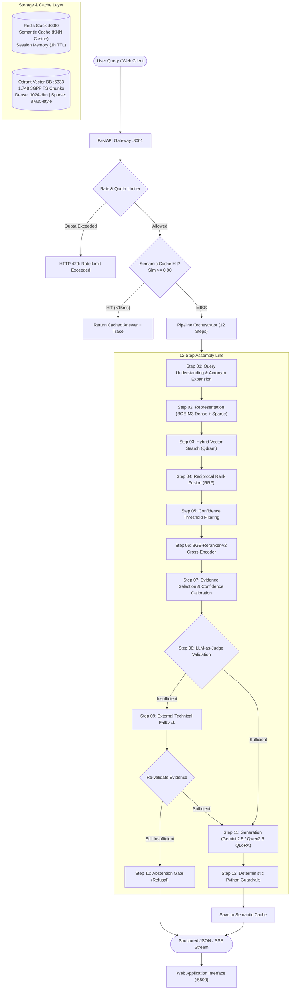

# 3GPP Telecom Quality Assurance Platform
### Domain-Adapted Retrieval-Augmented Generation (RAG) System for 5G/NR Technical Specifications

---

## 1. Executive Summary

Telecommunications standards published by the **3rd Generation Partnership Project (3GPP)** encompass thousands of densely interrelated technical specifications (e.g., TS 38.331, TS 38.211, TS 38.212). Standard Large Language Models (LLMs) consistently fail on telecommunications queries due to three fundamental domain challenges:
1. **Extreme Lexical and Acronym Density**: Hundreds of colliding acronyms (e.g., UE, AMF, SMF, UPF, RRC, BWP, PRACH).
2. **Cross-Release Protocol Shifts**: Procedures valid in Release 15/16 often conflict with enhancements in Release 17/18.
3. **Severe Hallucination Risks in Mission-Critical Infrastructure**: Generating incorrect numerical timers, slot formats, or message sequences can lead to protocol invalidity.

This project delivers a **production-grade, domain-adapted RAG platform** engineered specifically for 3GPP standards. It couples a hybrid retrieval engine (dense + sparse vector indexing) with a deterministic **12-Step RAG Pipeline Orchestrator**, real-time **Pipeline Observability Tracing**, **LLM-as-a-Judge Evidence Validation**, **Abstention Gating**, and post-generation **Deterministic Guardrails**.

---

## 2. End-to-End System Architecture



---

## 3. The 12-Step Pipeline Specification

The backend execution is governed by [`PipelineOrchestrator`](telecom_qa_backend/pipeline/orchestrator.py), which enforces a deterministic state machine over [`QueryContext`](telecom_qa_backend/core/schemas.py):

| Step | Module | Functionality | Algorithmic Method / Model |
|---|---|---|---|
| **01** | `step01_understanding` | Normalizes query, detects intent, and expands domain acronyms. | Structured LLM prompt -> `QueryUnderstanding` |
| **02** | `step02_representation` | Generates multi-modal dense and sparse query vectors. | `BAAI/bge-m3` (1024-dim dense + lexical sparse) |
| **03** | `step03_retrieval` | Executes dual-vector retrieval against Qdrant index. | Cosine dense search + Sparse dot product |
| **04** | `step04_fusion` | Merges dense and sparse result lists. | Reciprocal Rank Fusion (RRF, $k=60$) |
| **05** | `step05_filtering` | Prunes weak candidates before computationally expensive reranking. | Score cutoff filter (`MIN_FUSION_SCORE = 0.005`) |
| **06** | `step06_reranking` | Cross-encoder joint scoring of $(Query, Passage)$ pairs. | `BAAI/bge-reranker-v2-m3` (FP16 optimized) |
| **07** | `step07_selection` | Selects top-$K$ chunks within token context constraints; computes confidence. | Dynamic context window packing + Sigmoid calibration |
| **08** | `step08_validation` | Evaluates evidence sufficiency and checks for cross-chunk contradictions. | LLM-as-a-Judge verification protocol |
| **09** | `step09_web_fallback` | Supplementary search triggered only when local retrieval is insufficient. | Domain-restricted DuckDuckGo search (`ddgs`) |
| **10** | `step10_abstention` | Safety gate halting synthesis on out-of-domain or ungrounded queries. | Explicit abstention flag setting (`is_abstained=True`) |
| **11** | `step11_generation` | Context-grounded synthesis with mandatory bracketed citations. | Domain LLM (Gemini / Fine-tuned Qwen2.5) |
| **12** | `step12_guardrails` | Post-generation deterministic verification. | Python regex, citation resolution, version checks |

---

## 4. Grounding & Hallucination Guardrails

To meet strict telecommunications standards, generation output is gated by deterministic Python post-processors in [`step12_guardrails.py`](telecom_qa_backend/pipeline/step12_guardrails.py):

```
                                  [ Synthesized Answer ]
                                             │
             ┌───────────────────────────────┼───────────────────────────────┐
             ▼                               ▼                               ▼
    [ Citation Grounding ]         [ Numerical Verbatim ]         [ Release Consistency ]
   Asserts every [chunk_id]        Extracts all numeric tokens   Verifies all cited chunks
   in the answer strictly maps    and asserts exact appearance   belong to congruent 3GPP
    to selected context chunks.    in the retrieved evidence.      specification releases.
```

1. **Exact Citation Resolution**: Every citation tag `[chunk_id]` claimed by the LLM is resolved against `context.selected_evidence`. Any ungrounded chunk reference is flagged in `unresolved_citations`.
2. **Verbatim Numerical Grounding**: Telecom parameters (e.g., `15 kHz`, `slot 0`, `T300 = 1000ms`) are extracted using regex and cross-referenced against raw retrieved source chunks. Unmatched numbers are isolated in `ungrounded_numbers`.
3. **Cross-Release Conflict Detection**: Flags instances where evidence simultaneously cites disparate 3GPP releases (e.g., Rel-15 vs Rel-18), alerting the user to potential specification divergence.
4. **Abstention Decision Engine**: If validation declares evidence insufficient, the system refuses generation (`"I cannot answer based on verified 3GPP specifications"`) rather than hallucinating.

---

## 5. Caching, Telemetry & Free-Tier Protection

### Semantic Caching Layer (Redis Stack)
- Pre-retrieval vector similarity search using RediSearch KNN with Cosine distance.
- When an incoming query vector has $\ge 0.90$ similarity to a prior query, the full response is served from memory in **under 15 ms**, reducing LLM API consumption to zero.
- Dynamic TTL: 30 days for standardized specification queries; 24 hours for web-fallback queries.

### Pipeline Observability & Tracing
- Centralized context manager in [`core/tracer.py`](telecom_qa_backend/core/tracer.py) records duration, input chunk count, output chunk count, and metadata for every step.
- Full execution funnel is returned in the API contract (`PipelineTrace`) and rendered as an interactive funnel in the UI.

### Real-time SSE Streaming
- The `/query/stream` endpoint utilizes Server-Sent Events (SSE) to broadcast stage-by-stage pipeline progress (`step_progress`, `step_done`, `complete`) to the client, providing transparent latency visibility.

### Rate Limiting & Quota Management
- Implemented in [`services/rate_limiter.py`](telecom_qa_backend/services/rate_limiter.py) to prevent free-tier exhaustion:
  - **Per-minute sliding window**: Max 5 queries / minute per IP.
  - **Daily quota cap**: Max 30 queries / day per IP.
  - **Session turn cap**: Max 10 turns per conversation session.

---

## 6. Evaluation Suite & Benchmark Methodology

An automated evaluation harness is provided in [`evaluation/benchmark.py`](telecom_qa_backend/evaluation/benchmark.py), testing the live pipeline against 14 gold-standard test queries spanning:
- **Radio Resource Control (RRC)**: Connection establishment, state transitions, reconfiguration.
- **5G Core Network (5GC)**: AMF mobility, SMF session allocation, NRF service discovery, Network Slicing.
- **Physical Layer / RAN**: FR1 vs FR2 frequency allocations, Massive MIMO beamforming, FDD/TDD duplexing.
- **Network Security**: 5G-AKA authentication vectors, AUSF key exchange.
- **Out-of-Domain (OOD) Negative Controls**: Open-domain chit-chat, weather, general programming (verifies clean abstention).

### Evaluation Metrics Computed
$$\text{Abstention Accuracy} = \frac{\text{Correct In-Domain Answers} + \text{Correct OOD Refusals}}{\text{Total Test Cases}}$$
$$\text{Citation Resolution Rate} = \frac{\text{Resolved Context Citations}}{\text{Total Claimed Citations}}$$
$$\text{Numerical Grounding Rate} = 1 - \frac{\text{Ungrounded Numbers}}{\text{Total Numeric Entities}}$$

Run the benchmark suite:
```bash
python -m evaluation.benchmark
```
*Results are exported to timestamped JSON summaries in `telecom_qa_backend/evaluation/results/`.*

---

## 7. Model Fine-Tuning (QLoRA Adaptation)

A companion training pipeline ([`qlora_finetune.ipynb`](qlora_finetune.ipynb)) explores open-weights parameter-efficient fine-tuning:
- **Base Architecture**: `Qwen/Qwen2.5-1.5B-Instruct`
- **Domain Dataset**: `netop/TeleQnA` (telecom domain question-answering corpus)
- **Quantization & LoRA Configuration**: 4-bit NormalFloat (NF4) via bitsandbytes; LoRA rank $r=16$, $\alpha=16$ targeting projection matrices (`q_proj`, `k_proj`, `v_proj`, `o_proj`).
- **Hard Negative Training**: Trained explicitly on context-contamination samples to teach the model to emit structured abstention tokens when reference evidence does not contain the answer.

---

## 8. Quickstart Guide

### Prerequisites
- Python 3.11+
- Docker & Docker Compose
- Google Gemini API Key

### 1. Launch Vector DB and Semantic Cache
```bash
cd telecom_qa_backend
docker compose up -d qdrant redis
```
*Services:*
- **Qdrant**: `http://localhost:6333` (pre-populated with 1,748 chunks in `3gpp_standards`)
- **Redis**: `localhost:6380` (pre-loaded with 50+ cached questions in `dump.rdb`)

### 2. Configure Environment & Dependencies
```bash
# In telecom_qa_backend
python -m venv venv
source venv/bin/activate
pip install -r requirements.txt

# Create .env with your Gemini API key
echo "GEMINI_API_KEY=your_gemini_api_key_here" > .env
```

### 3. Start Backend API
```bash
uvicorn api.main:app --host 0.0.0.0 --port 8001
```
*Endpoints:*
- `GET  http://localhost:8001/health` — Service readiness & database point counts
- `POST http://localhost:8001/query` — Standard blocking RAG query
- `POST http://localhost:8001/query/stream` — Real-time SSE streaming query

### 4. Launch Web Application Interface
```bash
# In telecom_qa_frontend
python3 -m http.server 5500
```
Open **`http://localhost:5500`** in your browser.

---

## 9. Technology Stack Summary

- **Vector Database**: Qdrant (HNSW index, hybrid dense + sparse payload)
- **In-Memory Cache**: Redis Stack (RediSearch KNN Cosine similarity)
- **Embedding Model**: `BAAI/bge-m3` (FlagEmbedding, FP16 inference)
- **Reranker Model**: `BAAI/bge-reranker-v2-m3` (Cross-encoder, FP16 inference)
- **LLM Gateway**: Google Gemini API via official `google-genai` SDK
- **Backend Framework**: FastAPI, Pydantic v2, Uvicorn (ASGI)
- **Frontend Architecture**: Vanilla HTML5, Modern CSS, Native JavaScript (SSE EventSource)

---

## 10. Selected References

1. **Lewis, P., et al. (2020)**. *Retrieval-Augmented Generation for Knowledge-Intensive NLP Tasks*. Advances in Neural Information Processing Systems (NeurIPS).
2. **Karpukhin, V., et al. (2020)**. *Dense Passage Retrieval for Open-Domain Question Answering*. EMNLP 2020.
3. **Chen, J., et al. (2024)**. *BGE M3-Embedding: Multi-Lingual, Multi-Functionality, Multi-Granularity Text Embeddings Through Versatile Pre-Training*. arXiv:2402.03216.
4. **Dettmers, T., et al. (2023)**. *QLoRA: Efficient Finetuning of Quantized LLMs*. NeurIPS 2023.
5. **Zhang, T., et al. (2024)**. *RAFT: Adapting Language Model to Domain Specific RAG*. arXiv:2403.10131.
6. **Gururangan, S., et al. (2020)**. *Don't Stop Pretraining: Adapt Language Models to Domains and Tasks*. ACL 2020.
